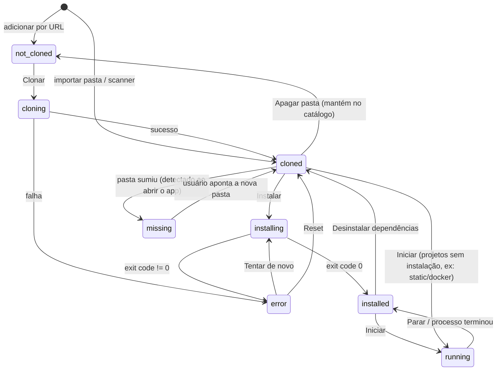
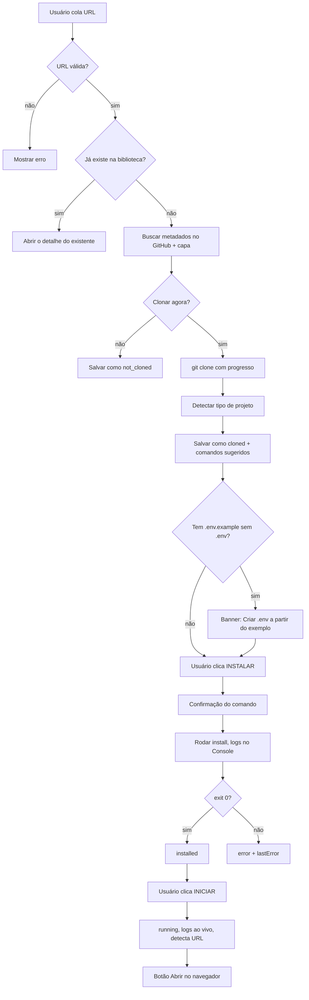

# Glibrary: especificação original da v1

> Documento histórico das fases 0–6. A aplicação evoluiu para o modelo v2 descrito no README,
> `AGENTS.md` e `docs/DECISOES.md`; consulte esses arquivos antes de contribuir.

---

## 1. Visão do produto

### 1.1 Problema
O usuário clona muitos repositórios do GitHub para a máquina. Com o tempo ele perde o controle:
- não sabe o que já foi clonado nem onde está;
- não sabe o que já teve as dependências instaladas;
- não lembra como rodar cada projeto (`npm run dev`? `python main.py`? `docker compose up`?);
- não sabe quais ferramentas (Node, Python, Docker, Git, etc.) tem instaladas nem quais cada projeto exige.

### 1.2 Solução
**Glibrary** é um app desktop no estilo **biblioteca da Steam**, só que no lugar de jogos há **repositórios**.

- Uma lista/grade com todos os repositórios, cada um com capa, nome, descrição e status.
- Cada repositório tem botões como na Steam: **Instalar**, **Iniciar**, **Parar**, **Atualizar**, **Desinstalar**.
- O app descobre sozinho os repositórios que já estão na máquina, detecta o tipo de projeto e sugere os comandos de instalação e execução.
- Uma tela de **Ferramentas** mostra o que está instalado no computador (Node, Python, Docker…) e o que falta para cada repositório.

### 1.3 Analogia Steam → Glibrary
| Steam | Glibrary |
|---|---|
| Jogo | Repositório |
| Loja / lista de desejos | Repositório adicionado só pela URL, ainda não clonado |
| Baixar | `git clone` |
| Instalar | Instalar dependências (`npm install`, `pip install -r …`) |
| Jogar | **Iniciar** (roda o comando de start) |
| Atualização disponível | Há commits novos no remoto (`git fetch`) |
| Desinstalar | Apagar dependências e/ou a pasta |
| Capa do jogo | Imagem social do GitHub (OpenGraph) ou capa gerada |
| Categorias / coleções | Tags e coleções |

### 1.4 Fora do escopo (não fazer na v1)
- Conta de usuário, login, sincronização em nuvem.
- Versão web/servidor. É **somente desktop e local**.
- Editar código dentro do app.
- Suporte a GitLab/Bitbucket (só GitHub e "qualquer URL git" genérica para clone).
- Gerenciar versões de runtime (nvm, pyenv). O app só **detecta** e **avisa**.

---

## 2. Stack técnica (obrigatória)

| Camada | Escolha | Motivo |
|---|---|---|
| Shell desktop | **Electron** (última versão estável) | Acesso a processos, arquivos e terminal; multiplataforma |
| Build | **electron-vite** | Template pronto main/preload/renderer com Vite |
| Linguagem | **TypeScript** (strict) em tudo | Tipos compartilhados entre main e renderer |
| UI | **React 18 + Tailwind CSS** | Rápido para montar a grade estilo Steam |
| Estado da UI | **Zustand** | Simples, sem boilerplate |
| Ícones | **lucide-react** | |
| Persistência | Arquivo **JSON** em `app.getPath('userData')/library.json`, com escrita atômica (grava em `.tmp` e renomeia) | Sem módulo nativo para compilar; centenas de repositórios cabem fácil |
| Git | **simple-git** | API Node para clone/pull/fetch/status |
| Processos | `child_process.spawn` + **tree-kill** | Parar o processo e todos os filhos (essencial no Windows) |
| Validação | **zod** | Validar dados do JSON e da IPC |
| Testes | **Vitest** | Testar detectores e o store |
| Empacotamento | **electron-builder** | Instalador Windows (.exe NSIS), macOS (.dmg), Linux (AppImage) |

Gerenciador de pacotes do próprio projeto: **pnpm**.

**Plataformas:** Windows 10/11 é prioridade, mas tudo precisa funcionar em macOS e Linux. Nunca use caminhos com `/` fixo: use `path.join`. Nunca assuma `bash`.

---

## 3. Arquitetura

```
┌───────────────────────────── Electron ─────────────────────────────┐
│                                                                    │
│  RENDERER (React)            PRELOAD               MAIN (Node)     │
│  ┌──────────────┐   window.api.*   ┌─────────┐   ipcMain.handle    │
│  │ Telas / UI   │ ───────────────▶ │ bridge  │ ──────────────────▶ │
│  │ Zustand      │ ◀─── eventos ─── │ seguro  │ ◀── webContents.send│
│  └──────────────┘                  └─────────┘                     │
│                                                ┌─────────────────┐ │
│                                                │ services/       │ │
│                                                │  library-store  │ │
│                                                │  git-service    │ │
│                                                │  detector       │ │
│                                                │  process-manager│ │
│                                                │  scanner        │ │
│                                                │  tools-checker  │ │
│                                                │  github-api     │ │
│                                                └─────────────────┘ │
└────────────────────────────────────────────────────────────────────┘
                     │ disco: library.json, covers/, logs/
                     │ rede: api.github.com (opcional)
```

Regras de arquitetura:
1. **O renderer nunca acessa Node direto.** `contextIsolation: true`, `nodeIntegration: false`, `sandbox: true`. Tudo passa por `window.api` exposto no preload.
2. Toda a lógica fica em `src/main/services/`. Os handlers de IPC são finos: validam com zod e chamam o serviço.
3. Os tipos ficam em `src/shared/types.ts`, importados pelo main e pelo renderer.
4. Saída de processos (logs) chega ao renderer por **eventos** (`webContents.send`), nunca por polling.

---

## 4. Estrutura de pastas

```
glibrary/
├─ package.json
├─ electron.vite.config.ts
├─ electron-builder.yml
├─ tailwind.config.js
├─ tsconfig*.json
├─ docs/
│  └─ DECISOES.md                # decisões tomadas durante a execução
├─ resources/                    # ícone do app
└─ src/
   ├─ shared/
   │  ├─ types.ts                # Repo, RepoStatus, Tool, Settings...
   │  ├─ ipc-channels.ts         # constantes com nomes dos canais
   │  └─ schemas.ts              # schemas zod
   ├─ main/
   │  ├─ index.ts                # cria a janela, registra a IPC
   │  ├─ ipc/
   │  │  ├─ repos.ipc.ts
   │  │  ├─ process.ipc.ts
   │  │  ├─ tools.ipc.ts
   │  │  └─ settings.ipc.ts
   │  └─ services/
   │     ├─ library-store.ts     # CRUD do library.json
   │     ├─ git-service.ts       # clone, pull, fetch, status
   │     ├─ detector/
   │     │  ├─ index.ts          # roda todos os detectores e junta o resultado
   │     │  ├─ node.ts
   │     │  ├─ python.ts
   │     │  ├─ docker.ts
   │     │  ├─ rust.ts
   │     │  ├─ go.ts
   │     │  ├─ dotnet.ts
   │     │  ├─ java.ts
   │     │  ├─ make.ts
   │     │  └─ static-html.ts
   │     ├─ process-manager.ts   # spawn, stop, logs, status
   │     ├─ scanner.ts           # encontra repositórios git em pastas
   │     ├─ tools-checker.ts     # verifica node/python/docker... instalados
   │     ├─ github-api.ts        # metadados e capa
   │     └─ cover-service.ts     # baixa ou gera capas
   ├─ preload/
   │  └─ index.ts                # expõe window.api tipado
   └─ renderer/
      ├─ index.html
      └─ src/
         ├─ main.tsx
         ├─ App.tsx
         ├─ store/               # zustand: library, processes, ui
         ├─ pages/
         │  ├─ LibraryPage.tsx
         │  ├─ RepoDetailPage.tsx
         │  ├─ ToolsPage.tsx
         │  └─ SettingsPage.tsx
         └─ components/
            ├─ Sidebar.tsx
            ├─ RepoCard.tsx
            ├─ RepoGrid.tsx
            ├─ RepoListItem.tsx
            ├─ StatusBadge.tsx
            ├─ ActionButton.tsx  # botão grande estilo "JOGAR"
            ├─ LogConsole.tsx
            ├─ AddRepoDialog.tsx
            ├─ ScanDialog.tsx
            ├─ CommandEditor.tsx
            └─ ConfirmDialog.tsx
```

---

## 5. Modelo de dados

### 5.1 `src/shared/types.ts`

```ts
export type RepoStatus =
  | 'not_cloned'     // só no catálogo (tem URL, não tem pasta)
  | 'cloning'
  | 'cloned'         // pasta existe, dependências não instaladas
  | 'installing'
  | 'installed'      // pronto para iniciar
  | 'running'
  | 'error'
  | 'missing';       // estava registrado, mas a pasta sumiu do disco

export type ProjectKind =
  | 'node' | 'python' | 'docker' | 'rust' | 'go'
  | 'dotnet' | 'java' | 'make' | 'static' | 'unknown';

export interface CommandSpec {
  command: string;          // ex: "pnpm install" ou "npm run dev"
  cwd?: string;             // relativo à raiz do repo; padrão "."
  env?: Record<string, string>;
}

export interface DetectionResult {
  kinds: ProjectKind[];             // pode ter mais de um (ex: node + docker)
  packageManager?: 'npm' | 'pnpm' | 'yarn' | 'bun' | 'pip' | 'poetry' | 'uv' | 'pipenv' | 'cargo' | 'go' | 'dotnet' | 'maven' | 'gradle';
  installCandidates: CommandSpec[]; // o primeiro é o sugerido
  startCandidates: CommandSpec[];
  requiredTools: string[];          // ids da tabela de ferramentas (seção 8)
  hasEnvExample: boolean;           // existe .env.example e não existe .env
  detectedPort?: number;            // se achou a porta (vite=5173, next=3000...)
}

export interface Repo {
  id: string;                       // uuid
  name: string;                     // ex: "excalidraw"
  owner?: string;                   // ex: "excalidraw"
  remoteUrl?: string;               // https://github.com/owner/name(.git)
  localPath?: string;               // caminho absoluto
  status: RepoStatus;
  description?: string;
  language?: string;
  stars?: number;
  topics?: string[];
  coverPath?: string;               // caminho local da imagem da capa
  tags: string[];                   // tags do usuário
  favorite: boolean;
  notes?: string;                   // anotações livres do usuário
  detection?: DetectionResult;
  installCommand?: CommandSpec;     // escolhido/editado pelo usuário
  startCommand?: CommandSpec;
  extraCommands?: { label: string; spec: CommandSpec }[]; // ex: "build", "test"
  openUrl?: string;                 // ex: http://localhost:5173 (botão "Abrir no navegador")
  addedAt: string;                  // ISO
  installedAt?: string;
  lastRunAt?: string;
  lastPulledAt?: string;
  behindBy?: number;                // commits atrás do remoto (último fetch)
  lastError?: string;
}

export interface Settings {
  reposRoot: string;                // pasta padrão para clonar; padrão: ~/Glibrary
  scanFolders: string[];            // pastas que o scanner varre
  githubToken?: string;             // opcional; salvar com safeStorage
  editorCommand: string;            // padrão: "code"
  terminalPreference: 'auto' | string;
  theme: 'dark' | 'light';          // padrão: dark (estilo Steam)
  viewMode: 'grid' | 'list';
  checkUpdatesOnStart: boolean;
}

export interface LibraryFile {
  version: 1;
  repos: Repo[];
  settings: Settings;
}
```

### 5.2 Regras de status (máquina de estados)



- Ao abrir o app, para cada repo com `localPath`: se a pasta não existe, o status vira `missing`.
- Ao abrir o app, status `running`/`installing`/`cloning` que ficaram salvos (o app fechou no meio) voltam para o último status estável (`installed` ou `cloned`).
- "Instalado" para projetos Node é inferido também pela existência de `node_modules/`; para Python, pela existência de `.venv/` ou `venv/`. Use isso ao importar pastas existentes.

---

## 6. Detecção de projeto (o coração do app)

Cada detector recebe o caminho do repositório e devolve um `DetectionResult` parcial ou `null`. O `detector/index.ts` junta todos. **Detectores só leem arquivos, nunca executam nada.**

| Detector | Arquivo-gatilho | Gerenciador | Instalar (sugestão) | Iniciar (sugestão) | Ferramentas |
|---|---|---|---|---|---|
| node | `package.json` | lockfile: `pnpm-lock.yaml`→pnpm, `yarn.lock`→yarn, `bun.lockb`/`bun.lock`→bun, senão npm | `<pm> install` | primeiro script existente nesta ordem: `dev`, `start`, `serve`, `preview` → `<pm> run <script>` | node + pm |
| python | `pyproject.toml`, `requirements.txt`, `Pipfile`, `setup.py` | `uv.lock`→uv, `poetry.lock`→poetry, `Pipfile`→pipenv, senão pip | pip: `python -m venv .venv` e depois `.venv/bin/pip install -r requirements.txt` (no Windows `.venv\Scripts\pip`) · poetry: `poetry install` · uv: `uv sync` | procurar nesta ordem: `manage.py`→`python manage.py runserver`; `app.py`/`main.py`→`python <arquivo>`; `[project.scripts]` no pyproject; streamlit no requirements → `streamlit run <arquivo>` | python + pm |
| docker | `docker-compose.yml`, `compose.yaml`, `Dockerfile` | — | `docker compose build` | `docker compose up` | docker |
| rust | `Cargo.toml` | cargo | `cargo build` | `cargo run` | cargo |
| go | `go.mod` | go | `go mod download` | `go run .` | go |
| dotnet | `*.sln`, `*.csproj` | dotnet | `dotnet restore` | `dotnet run` | dotnet |
| java | `pom.xml` / `build.gradle` | maven / gradle | `mvn install` / `./gradlew build` | `mvn spring-boot:run` (se tiver spring) / `./gradlew run` | java + mvn/gradle |
| make | `Makefile` | — | alvo `install`, se existir | alvo `run`/`dev`/`start`, se existir | make |
| static | `index.html` na raiz e nenhum outro tipo | — | — | `npx serve .` | node |

Detalhes:
- Python: o comando de iniciar deve usar o Python do venv quando ele existir (`.venv/bin/python` ou `.venv\Scripts\python.exe`).
- Porta: para Node, procurar `vite` (5173), `next` (3000), `react-scripts` (3000), `nuxt` (3000), `astro` (4321) nas dependências. Preencher `openUrl = http://localhost:<porta>`.
- Durante a execução, o process-manager também procura no log padrões como `http://localhost:\d+` e `http://127.0.0.1:\d+`. Se encontrar, atualiza `openUrl` e mostra o botão **Abrir no navegador**.
- Também ler o `README.md`: extrair os blocos de código que contenham `install`, `run`, `start` ou `dev` e mostrar como **"Comandos sugeridos pelo README"** no editor de comandos (só como sugestão clicável, nunca rodar sozinho).
- Monorepo: se `package.json` tiver `workspaces` ou existir `pnpm-workspace.yaml`, marcar e deixar o usuário escolher o `cwd`.
- A detecção roda: ao adicionar o repo, depois do clone, depois do pull e no botão manual **Detectar de novo**. Ela **nunca sobrescreve** `installCommand`/`startCommand` que o usuário editou (guardar um flag `commandsEditedByUser`).

---

## 7. Execução de processos (`process-manager.ts`)

API interna:
```ts
run(repoId: string, kind: 'install' | 'start' | 'extra', spec: CommandSpec): Promise<RunHandle>
stop(repoId: string): Promise<void>
getLogs(repoId: string): LogLine[]          // buffer em memória
isRunning(repoId: string): boolean
```

Regras:
1. `spawn(spec.command, { cwd, env: {...process.env, ...spec.env, FORCE_COLOR: '1'}, shell: true })`.
2. Só **um** processo ativo por repositório. Se já estiver rodando, o botão vira **Parar**.
3. Parar = `tree-kill(pid, 'SIGTERM')`; depois de 5 s, se ainda vivo, `SIGKILL`.
4. stdout e stderr viram linhas `{ ts, stream: 'out'|'err'|'sys', text }`, enviadas ao renderer pelo canal `process:log` e guardadas num buffer circular de **5.000 linhas** por repo.
5. Também gravar em arquivo: `userData/logs/<repoId>/<data>-<kind>.log`. Manter só os 10 últimos por repo.
6. No `exit`: emitir `process:exit` com o código; atualizar o status conforme a máquina de estados; gravar `lastError` com as últimas 20 linhas de stderr se o código for diferente de 0.
7. Ao fechar o app com processos rodando: mostrar diálogo "Há N repositórios rodando. Parar todos e sair?" e matar todos antes de sair.
8. Converter ANSI em cores no `LogConsole` (usar `ansi-to-html` ou `anser`).

**Segurança:**
- Nada é executado sem um clique explícito do usuário.
- Antes da **primeira** execução de um comando num repo (ou quando o comando muda), mostrar um diálogo com o comando exato, o `cwd` e o aviso: "Você vai executar código de terceiros na sua máquina."
- Nunca interpolar entrada do usuário em comandos montados por você mesmo. Para operações git, use a API do `simple-git` (argumentos em array), nunca `shell: true`.
- Validar URLs de clone: aceitar `https://…` e `git@…` apenas.

---

## 8. Verificador de ferramentas (`tools-checker.ts`)

Lista fixa de ferramentas. Para cada uma, rodar o comando de versão com `execFile` (sem shell), timeout de 3 s, e extrair a versão com regex.

| id | Nome | Comando | Link de download |
|---|---|---|---|
| git | Git | `git --version` | https://git-scm.com/downloads |
| node | Node.js | `node --version` | https://nodejs.org |
| npm | npm | `npm --version` | (vem com Node) |
| pnpm | pnpm | `pnpm --version` | https://pnpm.io/installation |
| yarn | Yarn | `yarn --version` | https://yarnpkg.com |
| bun | Bun | `bun --version` | https://bun.sh |
| python | Python | `python --version` (fallback `python3`, no Windows também `py`) | https://python.org |
| pip | pip | `pip --version` | |
| poetry | Poetry | `poetry --version` | https://python-poetry.org |
| uv | uv | `uv --version` | https://docs.astral.sh/uv |
| docker | Docker | `docker --version` | https://docker.com/get-started |
| cargo | Rust/Cargo | `cargo --version` | https://rustup.rs |
| go | Go | `go version` | https://go.dev/dl |
| dotnet | .NET | `dotnet --version` | https://dot.net |
| java | Java | `java -version` (sai no stderr) | https://adoptium.net |
| mvn | Maven | `mvn -v` | |
| make | Make | `make --version` | |
| code | VS Code | `code --version` | https://code.visualstudio.com |

- No Windows, comandos como `npm`, `pnpm` e `code` são `.cmd`: usar `execFile` com `shell: true` **só** para esses, ou procurar com `where`.
- Cache do resultado em memória; botão **Verificar de novo**.
- **Tela Ferramentas:** tabela com ✅ versão / ❌ não encontrado + link, e uma coluna "Usado por N repositórios" (clicável, filtra a biblioteca).
- **No card e no detalhe do repo:** se faltar alguma ferramenta de `requiredTools`, mostrar um aviso amarelo "Falta: Python, Docker" e desabilitar Instalar/Iniciar com tooltip explicando.

---

## 9. Scanner de repositórios existentes (`scanner.ts`)

Resolve o "não sei o que já tenho na máquina".

- Entrada: lista de pastas (`settings.scanFolders`), profundidade máxima **4**.
- Uma pasta é repositório se contém `.git/` (pasta ou arquivo, para worktrees). Ao achar uma, **não descer** dentro dela.
- Ignorar: `node_modules`, `.venv`, `venv`, `target`, `dist`, `build`, `.cache`, `AppData`, `Library`, `$Recycle.Bin`, `Program Files`, pastas ocultas (exceto `.git`).
- Para cada repo achado: ler o remoto `origin` (`git remote get-url origin`), o branch atual e rodar a detecção.
- Mostrar o resultado num diálogo com checkboxes: "Encontrados 47 repositórios, 12 já estão na biblioteca", com os novos pré-marcados. Botão **Importar selecionados**.
- Evitar duplicatas: um repo é o mesmo se tiver o mesmo `localPath` normalizado **ou** a mesma `remoteUrl` normalizada (sem `.git`, sem barra final, minúsculo, `git@github.com:a/b` igual a `https://github.com/a/b`). Se a URL for igual mas a pasta for diferente, perguntar ao usuário.
- Progresso via evento `scan:progress` (pasta atual, quantos achou). Botão de cancelar.

---

## 10. Integração com GitHub (`github-api.ts`)

- Endpoint: `GET https://api.github.com/repos/{owner}/{repo}`. Pegar `description`, `stargazers_count`, `language`, `topics`, `default_branch`, `html_url`.
- Token opcional (Configurações) para aumentar o rate limit; guardar criptografado com `safeStorage` do Electron. Sem token, funcionar com o limite anônimo e mostrar aviso amigável se chegar ao limite.
- **Capa:** baixar `https://opengraph.githubassets.com/1/{owner}/{repo}` e salvar em `userData/covers/<repoId>.png`. Se falhar ou não for GitHub, **gerar uma capa**: gradiente com cor derivada de hash do nome, as iniciais grandes e o ícone da linguagem. Gerar no renderer via canvas e salvar pelo main.
- Atualizar metadados: ao adicionar e no botão **Atualizar informações**. Nunca em loop.

---

## 11. Canais de IPC (contrato)

Todos tipados em `src/shared/ipc-channels.ts` e expostos em `window.api` pelo preload.

| Canal | Direção | Entrada | Saída |
|---|---|---|---|
| `library:get` | invoke | — | `LibraryFile` |
| `repo:addByUrl` | invoke | `{ url, clone: boolean }` | `Repo` |
| `repo:addLocal` | invoke | `{ path }` | `Repo` |
| `repo:update` | invoke | `{ id, patch: Partial<Repo> }` | `Repo` |
| `repo:remove` | invoke | `{ id, deleteFolder: boolean }` | `void` |
| `repo:clone` | invoke | `{ id }` | `void` (progresso via evento) |
| `repo:detect` | invoke | `{ id }` | `DetectionResult` |
| `repo:pull` | invoke | `{ id }` | `{ updated: boolean, summary }` |
| `repo:fetchStatus` | invoke | `{ id }` | `{ behindBy, ahead, dirty }` |
| `repo:uninstallDeps` | invoke | `{ id }` | `void` (apaga `node_modules`/`.venv`/`target`) |
| `repo:refreshMeta` | invoke | `{ id }` | `Repo` |
| `repo:openFolder` | invoke | `{ id }` | — (`shell.openPath`) |
| `repo:openEditor` | invoke | `{ id }` | — |
| `repo:openTerminal` | invoke | `{ id }` | — |
| `repo:openBrowser` | invoke | `{ id }` | — (`shell.openExternal(openUrl)`) |
| `repo:createEnv` | invoke | `{ id }` | — (copia `.env.example` para `.env` e abre no editor) |
| `process:run` | invoke | `{ id, kind, extraIndex? }` | `void` |
| `process:stop` | invoke | `{ id }` | `void` |
| `process:getLogs` | invoke | `{ id }` | `LogLine[]` |
| `process:log` | evento | `{ id, line }` | |
| `process:exit` | evento | `{ id, code }` | |
| `repo:statusChanged` | evento | `{ id, status }` | |
| `clone:progress` | evento | `{ id, percent, stage }` | |
| `scan:start` | invoke | `{ folders }` | `ScanResult[]` |
| `scan:progress` | evento | `{ current, found }` | |
| `scan:cancel` | invoke | — | |
| `tools:check` | invoke | `{ force?: boolean }` | `ToolStatus[]` |
| `settings:get` / `settings:set` | invoke | `Partial<Settings>` | `Settings` |
| `dialog:pickFolder` | invoke | — | `string \| null` |

**Abrir terminal:** Windows: `wt -d <path>`, com fallback para `cmd /K cd /d <path>`; macOS: `open -a Terminal <path>`; Linux: tentar `x-terminal-emulator`, `gnome-terminal`, `konsole` nessa ordem.

---

## 12. Mapa de telas (UI)

Visual: **tema escuro estilo Steam**. Paleta base: fundo `#171a21`, painel `#1b2838`, painel elevado `#2a475e`, texto `#c7d5e0`, destaque/ação `#66c0f4`, botão "Iniciar" verde `#5ba32b`, erro `#c94a4a`, aviso `#d8a031`.

```
┌──────────────────────────────────────────────────────────────────────┐
│ GLIBRARY   [Biblioteca] [Ferramentas] [Configurações]   🔍 buscar... │
├──────────────┬───────────────────────────────────────────────────────┤
│ SIDEBAR      │  [+ Adicionar]  [⟳ Escanear pastas]   Grade|Lista     │
│              │  Filtro: Todos ▾  Ordenar: Último uso ▾               │
│ ★ Favoritos  │                                                       │
│ ▶ Rodando (2)│  ┌──────┐ ┌──────┐ ┌──────┐ ┌──────┐                  │
│ ✓ Instalados │  │ capa │ │ capa │ │ capa │ │ capa │                  │
│ ↓ Não clonad.│  │      │ │      │ │      │ │      │                  │
│ ⚠ Com erro   │  │nome  │ │nome  │ │nome  │ │nome  │                  │
│ ⟳ Atualizaç. │  │●stat │ │●stat │ │●stat │ │●stat │                  │
│ ─────────    │  └──────┘ └──────┘ └──────┘ └──────┘                  │
│ TAGS         │                                                       │
│ #ia          │                                                       │
│ #ferramentas │                                                       │
│ ─────────    │                                                       │
│ LISTA (A-Z)  │                                                       │
│ • excalidraw │                                                       │
│ • ollama     │                                                       │
└──────────────┴───────────────────────────────────────────────────────┘
```

### 12.1 Biblioteca (`LibraryPage`)
- Sidebar esquerda com coleções automáticas (Favoritos, Rodando, Instalados, Não clonados, Com erro, Com atualização), as tags do usuário e a lista alfabética compacta de todos os repos (como a Steam).
- Área principal: grade de cards (capa 16:9, nome, linguagem, badge de status, estrela de favorito). Hover no card mostra botão rápido **Iniciar/Instalar**.
- Modo lista: tabela com Nome, Status, Linguagem, Caminho, Último uso, Tamanho (opcional).
- Busca por nome, owner, descrição, tags e caminho. Atalho `Ctrl+K` / `Cmd+K` foca a busca.
- Ordenação: Nome, Último uso, Data de adição, Estrelas.
- Estado vazio: ilustração + dois botões grandes: **Escanear minhas pastas** e **Adicionar por URL**.

### 12.2 Detalhe do repositório (`RepoDetailPage`)
```
┌──────────────────────────────────────────────────────────────┐
│                  [ CAPA / BANNER grande ]                     │
│ owner / nome                                     ★ ⋯ (menu)  │
├──────────────────────────────────────────────────────────────┤
│ [ ▶ INICIAR ]  Última execução: há 2 dias   ⚠ Falta: Docker   │
│ [📁 Pasta] [</> VS Code] [>_ Terminal] [🌐 Navegador] [GitHub]│
├───────────────┬──────────────────────────────────────────────┤
│ Abas: Visão geral | Console | Comandos | Notas                │
│                                                              │
│ Visão geral: descrição, ⭐ estrelas, linguagem, tópicos,      │
│ caminho local, branch, "3 commits atrás" [Atualizar],        │
│ tipos detectados, ferramentas exigidas (✅/❌), tags editáveis │
│                                                              │
│ Console: LogConsole com cores ANSI, auto-scroll, copiar,     │
│ limpar, abrir arquivo de log                                 │
│                                                              │
│ Comandos: instalar/iniciar editáveis, candidatos detectados, │
│ sugestões do README, comandos extras (+ adicionar)           │
│                                                              │
│ Notas: textarea livre (salva com debounce de 500 ms)         │
└──────────────────────────────────────────────────────────────┘
```
O **botão principal** muda conforme o status (igual à Steam):

| Status | Botão principal | Cor |
|---|---|---|
| not_cloned | **CLONAR** | azul |
| cloning | barra de progresso + Cancelar | azul |
| cloned | **INSTALAR** (ou **INICIAR** se não precisa instalar) | azul / verde |
| installing | spinner + **Cancelar** | azul |
| installed | **▶ INICIAR** | verde |
| running | **■ PARAR** | cinza/vermelho |
| error | **TENTAR DE NOVO** + "Ver erro" | vermelho |
| missing | **LOCALIZAR PASTA** | amarelo |

Menu ⋯: Detectar de novo, Atualizar informações do GitHub, Desinstalar dependências, Remover da biblioteca, Remover e apagar pasta (confirmação digitando o nome do repo).

### 12.3 Adicionar repositório (`AddRepoDialog`)
- Aba **Por URL**: campo de URL (aceita colar `github.com/owner/repo` sem `https://`), checkbox "Clonar agora" (marcado), pasta de destino (padrão `reposRoot/<nome>`), preview com nome e descrição buscados no GitHub.
- Aba **Pasta local**: escolher pasta; validar que tem `.git` (se não tiver, permitir mesmo assim, avisando "sem controle de versão").

### 12.4 Ferramentas (`ToolsPage`)
Tabela da seção 8 + resumo no topo: "12 de 18 ferramentas instaladas".

### 12.5 Configurações (`SettingsPage`)
Pasta padrão de clones, pastas do scanner (adicionar/remover), token do GitHub, comando do editor, terminal, tema, verificar atualizações ao iniciar, exportar/importar `library.json` (backup).

---

## 13. Fluxos principais

### 13.1 Adicionar por URL e rodar


### 13.2 Primeira abertura do app (onboarding)
1. Criar `library.json` com as configurações padrão.
2. Tela de boas-vindas: "Onde ficam seus projetos?" com sugestões automáticas das pastas que existirem entre `~/Projects`, `~/projetos`, `~/dev`, `~/code`, `~/source/repos`, `~/Documents/GitHub`, `~/Desktop`.
3. Rodar o scanner e importar.
4. Rodar o verificador de ferramentas em segundo plano.

### 13.3 Ao iniciar o app (todas as vezes)
1. Carregar a biblioteca e corrigir status presos (seção 5.2).
2. Marcar `missing` em pastas que sumiram.
3. Se `checkUpdatesOnStart`: `git fetch` em segundo plano, **no máximo 4 em paralelo**, preenchendo `behindBy`. Nunca fazer pull automático.

---

## 14. Plano de execução (fases)

> Cada fase termina com o app **compilando e abrindo**. Commit ao fim de cada item, no formato `feat(fase-N): descrição`. Não comece uma fase sem os critérios de aceite da anterior atendidos.

### Fase 0: Setup
- [ ] Criar o projeto com `pnpm create @quick-start/electron` (template react-ts) **dentro da raiz deste repositório**.
- [ ] Adicionar Tailwind, Zustand, lucide-react, zod, simple-git, tree-kill, Vitest, ESLint + Prettier.
- [ ] Configurar `contextIsolation`, `sandbox` e um CSP restritivo no `index.html`.
- [ ] Criar `src/shared/types.ts` exatamente como na seção 5.1.
- [ ] Scripts: `dev`, `build`, `typecheck`, `lint`, `test`, `dist`.
- **Aceite:** `pnpm dev` abre uma janela escura com o título "Glibrary"; `pnpm typecheck` e `pnpm lint` passam.

### Fase 1: Persistência + biblioteca manual
- [ ] `library-store.ts`: carregar/salvar com escrita atômica, validação zod, migração por `version`, backup `library.backup.json` a cada salvamento bem-sucedido.
- [ ] IPC `library:get`, `repo:addLocal`, `repo:update`, `repo:remove`, `dialog:pickFolder`, `settings:*`.
- [ ] UI: layout com sidebar, grade de cards com capa gerada, busca, favoritos, tags.
- **Aceite:** adicionar 3 pastas locais, fechar e reabrir o app, e tudo continua lá. Testes do store passando.

### Fase 2: Detecção
- [ ] Todos os detectores da seção 6 + leitura do README.
- [ ] Testes Vitest com fixtures em `tests/fixtures/` (um mini repo falso por tipo).
- [ ] Aba **Comandos** no detalhe, com edição e flag `commandsEditedByUser`.
- **Aceite:** cada fixture devolve os comandos esperados; editar um comando e rodar **Detectar de novo** não apaga a edição.

### Fase 3: Execução de processos
- [ ] `process-manager.ts` completo (seção 7), `LogConsole` com ANSI e auto-scroll.
- [ ] Botão principal dinâmico (tabela da 12.2), diálogo de confirmação na primeira execução.
- [ ] Detecção de URL no log e botão **Abrir no navegador**.
- [ ] Diálogo ao fechar com processos rodando.
- **Aceite:** num projeto Vite real, Instalar → Iniciar → abrir o navegador → Parar funciona, e após parar nenhum processo `node` órfão continua vivo (conferir no Gerenciador de Tarefas / `ps`).

### Fase 4: Git + GitHub
- [ ] `git-service.ts`: clone com progresso, pull, fetch/status, cancelar o clone.
- [ ] `repo:addByUrl` com normalização de URL e prevenção de duplicatas.
- [ ] `github-api.ts` + `cover-service.ts` (OpenGraph + capa gerada como fallback).
- [ ] Coleção "Com atualização" e botão **Atualizar** (pull) quando `behindBy > 0`.
- **Aceite:** colar `https://github.com/sindresorhus/is` clona com barra de progresso, mostra capa, descrição e estrelas, e detecta Node.

### Fase 5: Scanner + Ferramentas
- [ ] `scanner.ts` (seção 9) + `ScanDialog` com progresso e cancelar.
- [ ] `tools-checker.ts` (seção 8) + `ToolsPage` + avisos "Falta: X" nos repos.
- [ ] Onboarding da primeira abertura (13.2).
- **Aceite:** escanear uma pasta com 20+ repos leva menos de 10 s, não cria duplicatas ao rodar duas vezes e não entra em `node_modules`.

### Fase 6: Acabamento
- [ ] Abrir pasta / editor / terminal / GitHub (multiplataforma).
- [ ] `.env.example` → `.env`; desinstalar dependências; remover com confirmação digitada.
- [ ] Modo lista, ordenações, atalhos (`Ctrl+K` busca, `Enter` no card abre, `Esc` volta).
- [ ] Exportar/importar a biblioteca.
- [ ] `electron-builder` gerando o instalador do Windows; ícone do app.
- [ ] `README.md` do projeto (em português): o que é, prints, como rodar em dev, como gerar o instalador.
- **Aceite:** `pnpm dist` gera um instalador que instala e abre numa máquina sem o projeto de desenvolvimento.

### Backlog (só depois da v1, não implementar agora)
- Ícone na bandeja do sistema mostrando os repos rodando.
- Perfis de execução múltiplos (frontend + backend juntos).
- Estatística de "tempo rodando" por repo (como as horas jogadas na Steam).
- Importar suas estrelas do GitHub como lista de desejos.
- Tamanho em disco por repo e botão "liberar espaço" (apagar `node_modules` de repos não usados há 30 dias).

---

## 15. Diretrizes para o agente executor

1. **Ordem:** siga as fases 0→6. Não pule.
2. **Escopo:** implemente só o que está aqui. Ideias extras vão para `docs/DECISOES.md`, seção "Sugestões", sem implementar.
3. **Tipos primeiro:** antes de cada serviço, defina e exporte os tipos e o schema zod.
4. **Sem `any`.** TypeScript strict. Se precisar, use `unknown` e valide.
5. **Erros:** todo handler de IPC devolve `{ ok: true, data } | { ok: false, error: string }`. A UI mostra o erro em toast, sem travar a tela.
6. **Mensagens da UI em português do Brasil.** Código, nomes de variáveis e commits em inglês.
7. **Multiplataforma:** `path.join`, `os.homedir()`, sem comandos bash-only. Testar mentalmente o caminho do Windows em tudo que mexe com processos e terminal.
8. **Segurança:** nunca rodar comando sem clique; nunca `shell: true` com string montada a partir de entrada do usuário (exceto os comandos de instalar/iniciar, que o usuário vê e aprova); apagar pasta só com confirmação digitada; token sempre via `safeStorage`.
9. **Performance:** operações de disco e git são assíncronas; nada bloqueia o main process; fetch em paralelo limitado a 4.
10. **Testes mínimos obrigatórios:** detectores, normalização de URL, deduplicação do scanner, máquina de estados do status.
11. **Antes de cada commit:** `pnpm typecheck && pnpm lint && pnpm test`.
12. **Dúvida?** Escolha o mais simples, registre em `docs/DECISOES.md` e siga em frente. Não pare a execução para perguntar, a não ser que algo bloqueie de verdade.

---

## 16. Definição de pronto (v1)

O usuário consegue, sem abrir o terminal:
1. Abrir o Glibrary pela primeira vez, escanear as pastas e ver **todos** os repositórios que já tem na máquina, com capa e status.
2. Saber na hora quais estão instalados, quais não estão e quais têm atualização.
3. Ver quais ferramentas tem instaladas e o que falta para cada projeto.
4. Colar uma URL do GitHub e ter o repo clonado, detectado e pronto para instalar.
5. Clicar em **Instalar**, depois em **▶ Iniciar**, ver os logs e abrir no navegador.
6. Clicar em **■ Parar** e o processo morrer por completo.
7. Fechar e reabrir o app e encontrar tudo exatamente como deixou.
